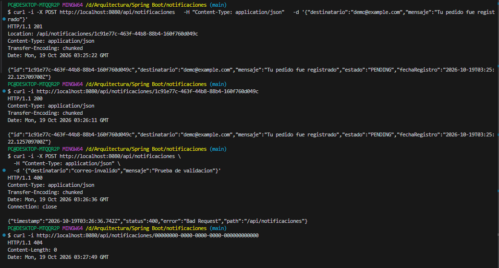

# Registro y consulta de notificaciones

Verificación manual realizada el 18 de octubre de 2026.

| Caso probado | Resultado obtenido |
|---|---|
| Registrar correo y mensaje válidos | 201 Created |
| Consultar el identificador registrado | 200 OK |
| Registrar un correo inválido | 400 Bad Request |
| Consultar un UUID inexistente | 404 Not Found |

La solicitud válida quedó registrada con estado PENDING.
No se realizó ningún envío de correo.

Los datos se almacenan en memoria y se pierden al reiniciar
la aplicación. Estas comprobaciones son manuales; todavía
no hay pruebas automatizadas para estos endpoints.

## Captura de la prueba

