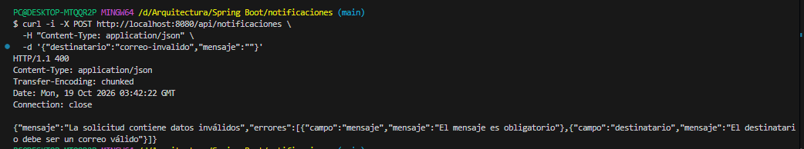

# Errores de validación por campo

Se envió una solicitud con destinatario "correo-invalido"
y mensaje vacío.

La API respondió HTTP 400 e informó ambos errores:
- mensaje: El mensaje es obligatorio.
- destinatario: El destinatario debe ser un correo válido.

Comprobación manual del manejador de errores de validación.

