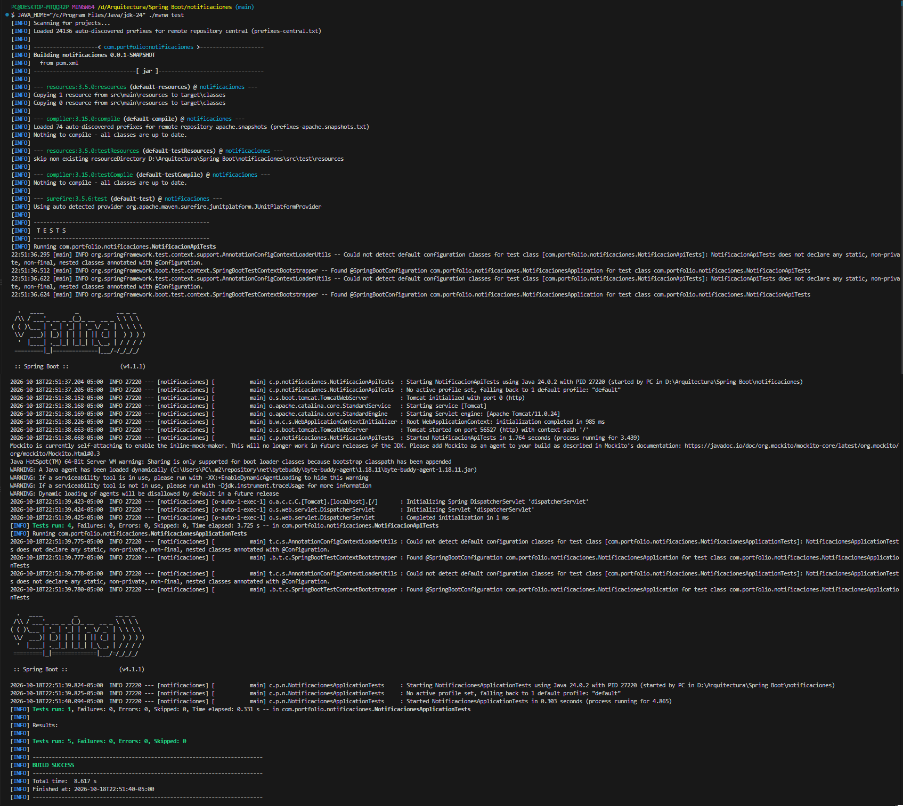

# Pruebas automatizadas

Ejecución local: 18 de octubre de 2026.
Resultado: 5 pruebas, 0 fallos, 0 errores y 0 omitidas.

## Comportamientos comprobados

- Registro y consulta de una notificación.
- Rechazo de correo inválido y mensaje vacío.
- Rechazo de mensajes mayores a 1000 caracteres.
- Respuesta 404 para una notificación inexistente.
- Carga del contexto de Spring.

Las pruebas de la API realizan solicitudes HTTP contra un
servidor local iniciado automáticamente en un puerto libre.

